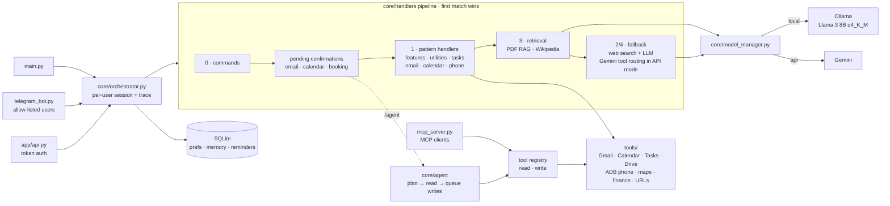

# Orchestrix: Multi-Model Agentic AI Assistant

[](https://github.com/saisaharsh3/Orchestrix_AI-Multi-Model_Agentic_AI_Assistant/actions/workflows/ci.yml)

Orchestrix is a hybrid-inference personal assistant that runs on your own
machine. For every request it decides whether a model is needed at all,
whether the on-device model (Llama 3 8B via Ollama) is enough, or whether to
use the cloud (Gemini). It connects to Gmail, Google Calendar, Tasks and
Drive, controls an Android phone over ADB, answers questions about your PDFs
entirely on-device, and is reachable from a terminal, a Telegram bot, or an
HTTP API.

## The problem it addresses

1. **Edge vs. cloud.** Cloud models reason better but add latency, cost and
   privacy exposure; local models keep data private but are limited by
   consumer hardware. Orchestrix routes each request to the cheapest place
   that can handle it, local first.
2. **Data sovereignty.** Typical RAG pipelines send document chunks to a
   remote model. Orchestrix embeds, searches and answers over your PDFs on
   your own CPU/GPU in local mode.
3. **VRAM limits.** An 8B model does not fit in a 4 GB laptop GPU. Orchestrix
   runs a 4-bit (q4_K_M) Llama 3 8B with 20 layers offloaded to the GPU and
   the rest on the CPU.
4. **Stylometric fingerprinting.** If the same person sends some queries to
   the cloud and keeps others local, their writing style can link the two.
   Stealth Mode normalises query style before it leaves the device.

## Highlights

- **Agent mode.** `/agent <goal>` plans and chains several steps — look up the
  forecast, check your calendar, draft an email — then shows the plan and
  waits for one YES before anything is sent or created.
- **MCP server.** Claude Desktop, Claude Code, Cursor or any other MCP client
  can use Orchestrix's tools, including search over your on-device PDF index.
- **Deterministic routing first.** Pattern-based handlers cover common
  requests (tasks, calendar, email, weather, reminders, phone control)
  without calling a model to decide what to do.
- **Local-first privacy.** In local mode nothing is sent to a cloud model —
  including PDF content and email drafts. If the local model fails you are
  told, and you choose `/api` yourself; there is no silent cloud fallback.
- **On-device PDF Q&A.** FAISS `IndexFlatIP` over 384-dimensional
  `all-MiniLM-L6-v2` embeddings, hybrid semantic + keyword retrieval, optional
  OCR for scanned pages.
- **Gemini function calling** (API mode) catches phrasings the patterns
  miss, restricted to read-only tools (weather, prices, calendar, inbox, Drive).
- **Stealth Mode** reduced cross-mode stylometric similarity by 18.5% in our
  experiment (synthetic queries; see [research](research/README.md)).
- **Confirm before acting.** Sending email and adding calendar events always
  wait for an explicit YES.

## Architecture



Each request passes through `core/handlers/` in order. The stage that answered
it is logged to `research/logs/orchestration_trace.jsonl`:

| Stage | Handled by | Model involved |
|---|---|---|
| 0 | slash commands | none |
| 1 | pattern-matched handlers | none for routing (some tools draft text with the LLM) |
| 2 | Gemini picked a read-only tool | Gemini (API mode only) |
| 3 | PDF RAG / Wikipedia | session model for RAG answers |
| 4 | general answer, optionally web-grounded | session model |
| 5 | `/agent` multi-step run | session model (planner) |

## Quick start

### 1. Prerequisites

- Python 3.10+
- [Ollama](https://ollama.com) with the default model:
  `ollama pull llama3:8b-instruct-q4_K_M`
- A [Gemini API key](https://aistudio.google.com/apikey) for API mode
- Optional: NVIDIA GPU (`OLLAMA_NUM_GPU` layers offloaded, default 20), `adb`
  for phone control, ffmpeg for voice, Tesseract + Poppler for OCR

### 2. Install

```bash
git clone https://github.com/saisaharsh3/Orchestrix_AI-Multi-Model_Agentic_AI_Assistant.git
cd Orchestrix_AI-Multi-Model_Agentic_AI_Assistant
python -m venv venv
source venv/bin/activate          # Windows: venv\Scripts\activate
pip install -r requirements.txt
# optional extras
pip install -r requirements-voice.txt     # Whisper voice messages, mic input
pip install -r requirements-extras.txt    # OCR, browser automation (Playwright)
```

### 3. Configure

```bash
cp .env.example .env
```

Fill in at least `GEMINI_API_KEY`. Every setting is documented in
[.env.example](.env.example).

**Telegram bot:** create a bot with [@BotFather](https://t.me/BotFather), put
the token in `TELEGRAM_BOT_TOKEN`, and your Telegram user id (ask
[@userinfobot](https://t.me/userinfobot)) in `TELEGRAM_ALLOWED_USER_IDS`.
The bot refuses to start without an allow-list, because it can read your mail
and control your phone.

**Google APIs (Gmail, Calendar, Tasks, Drive):** in Google Cloud Console,
enable the four APIs, create an OAuth client of type *Desktop app*, and save
its JSON as `credentials/credentials.json`. The first Google request opens a
browser for consent and stores `credentials/token.json`; if that token is
later revoked, the consent flow runs again automatically.

### 4. Run

```bash
python main.py                                   # terminal
python telegram_bot.py                           # Telegram bot
python mcp_server.py                             # MCP server (for MCP clients)
uvicorn app.api:app --host 127.0.0.1 --port 8000 # HTTP API
```

```bash
curl -X POST localhost:8000/chat -F message="weather in Pune" -F model_type=local
```

Set `ORCHESTRIX_API_TOKEN` and send `Authorization: Bearer <token>` to allow
non-localhost clients.

### Docker

```bash
docker compose up -d
docker compose exec ollama ollama pull llama3:8b-instruct-q4_K_M
docker compose --profile api up -d api   # optional HTTP API on 127.0.0.1:8000
```

Authorise Google once on the host (so `credentials/token.json` exists) before
running in Docker; the consent flow needs a browser.

## Agent mode

Ordinary messages trigger at most one action. `/agent` hands a whole goal to
a planner that can use 22 tools in sequence:

```
/agent check the weather in Goa tomorrow; if it's sunny add a beach day at 10am
       to my calendar and email ravi@example.com about it
```

```
🤖 Goal: check the weather in Goa tomorrow; if it's sunny …
Looked up:
1. get_forecast(days=2, city=Goa)
   → Forecast for Goa, IN: … clear sky …

Waiting for your approval:
1. create_calendar_event   title: Beach Day · start: 2026-10-11T10:00
2. send_email              to: ravi@example.com · subject: Beach Day in Goa tomorrow · body: …
Reply YES to run these, or NO to cancel.
```

- **Read tools** (weather, prices, inbox, calendar, Drive, web, Wikipedia,
  your PDFs, conversation history) run immediately.
- **Write tools** (send email, save draft, create event, add task, phone
  alarm) are only queued; nothing changes until you reply YES.
- **API mode** uses Gemini's native function calling. **Local mode** uses a
  JSON-constrained planner on the local model, so the whole run stays on
  your machine.
- The plan is capped at `AGENT_MAX_STEPS` planner turns; repeated calls are
  de-duplicated; a failing tool is reported back to the planner so it can
  recover.

Implementation: [core/agent/](core/agent/) (tool registry, loop, planners)
and [core/handlers/agent.py](core/handlers/agent.py).

## Use Orchestrix from Claude Desktop, Cursor, … (MCP)

[mcp_server.py](mcp_server.py) exposes the same tool registry over the
[Model Context Protocol](https://modelcontextprotocol.io). Any MCP client can
then search your local PDFs, read your calendar and inbox, or check prices —
through your own assistant, with your data staying on your machine except
for what that client's model sees in the results.

Claude Desktop (`claude_desktop_config.json`):

```json
{
  "mcpServers": {
    "orchestrix": {
      "command": "C:/path/to/Orchestrix/venv/Scripts/python.exe",
      "args": ["C:/path/to/Orchestrix/mcp_server.py"]
    }
  }
}
```

Claude Code: `claude mcp add orchestrix -- python /path/to/Orchestrix/mcp_server.py`

- Only the 17 read-only tools are exposed by default. Set
  `ORCHESTRIX_MCP_ALLOW_WRITE=true` to also expose email, calendar, task and
  phone tools plus `ask_orchestrix` (the full assistant).
- The server acts as `ORCHESTRIX_MCP_USER` (default `TELEGRAM_CHAT_ID`), so it
  sees the PDFs you uploaded through the bot.
- If that user has documents, the embedding model loads before the server
  starts listening (~10 s), so searches answer in about a second.

## What you can say

| Area | Examples |
|---|---|
| Everyday | `weather in Mumbai` · `convert 500 USD to INR` · `TCS stock price` · `bitcoin price` |
| Web | `summarize https://…` · `track price https://…` · `show tracked prices` |
| Google | `check my email` · `send email to a@b.com use ai write about the launch` · `add meeting with Ravi tomorrow at 3pm` · `add task buy milk` · `find resume on drive` |
| Reminders (Telegram) | `remind me to call mom at 6pm` · `show my reminders` |
| PDFs | send a PDF, then ask about it · `compare the two PDFs` · `generate a summary report` |
| Maps | `find restaurants nearby` · `directions to the airport` (share your location first) |
| Phone (ADB) | `open youtube` · `play lofi on spotify` · `set alarm for 7:30am` · `set volume to 40%` |
| Multi-step | `/agent <goal>` — plans, looks things up, then asks before acting |
| Controls | `/api` · `/local` · `/web on` · `/rag on` · `/stealth_mode on` · `/status` |

## Results

Hardware: AMD Ryzen 7 6800HS, NVIDIA RTX 3050 Ti Laptop GPU (4 GB),
16 GB RAM.

**Latency** ([research/results/benchmark_results.json](research/results/benchmark_results.json),
3 prompts × 3 runs per model; reproduce with `python scripts/benchmark.py`):

| | Mean latency |
|---|---|
| Local, Llama 3 8B q4_K_M (Ollama, 20 GPU layers) | 1.06 – 1.19 s |
| Cloud, Gemini Flash | 1.94 – 2.01 s |
| FAISS retrieval over one PDF | 6 – 19 ms per query (5 queries) |

**Routing** (Experiment 1, 39 requests traced in March 2026): 12.8% were
handled by pattern handlers without an LLM; 87.2% needed a model.


**Stylometric linkability** (Experiment 5, synthetic queries): mean
cross-mode similarity fell from 0.846 to 0.689 (−18.5%) with style
normalisation; high-confidence links fell from 16/20 to 6/20. Paraphrasing
gave no improvement and random obfuscation 3.7%.


Not yet measured: confidence calibration (ECE needs human-labelled answers)
and per-category local-vs-cloud latency on the full test set. How to run
every experiment, and what each one does and does not show, is in
[research/README.md](research/README.md).

## Technology stack

| Layer | Used |
|---|---|
| Local inference | Ollama (llama.cpp, GGUF), Llama 3 8B Instruct, q4_K_M |
| Cloud inference | Google Gemini (`gemini-flash-latest`, configurable) |
| Retrieval | FAISS `IndexFlatIP`, sentence-transformers `all-MiniLM-L6-v2` (384-d), pypdf, Tesseract OCR |
| Interfaces | python-telegram-bot, FastAPI, terminal, MCP (stdio) |
| Integrations | Google APIs (Gmail, Calendar, Tasks, Drive), ADB, Playwright, OpenStreetMap, yfinance, DuckDuckGo |
| Storage | SQLite |
| Voice | OpenAI Whisper (local), pyttsx3 |

## Project layout

```
app/            HTTP API (FastAPI)
mcp_server.py   MCP server (stdio)
config/         settings (single place that reads .env) and user preferences
core/
  orchestrator.py   request entry point, tracing
  handlers/         routing pipeline, one module per area
  session.py        per-user state (pending actions, toggles, PDFs)
  storage.py        SQLite persistence
  model_manager.py  local/cloud generation with the privacy rule
  agent/            tool registry, agent loop, Gemini + local planners
  tool_router.py    single-step Gemini function calling over read-only tools
models/         Ollama and Gemini clients
rag/            FAISS vector store
tools/          integrations (Google, phone/ADB, maps, finance, URLs, search)
research/       experiments and results
scripts/        benchmarks
tests/          pytest suite (no network, no models needed)
```

## Development

```bash
pip install -r requirements-dev.txt
pytest                 # ~100 tests, all external services faked
ruff check .
pre-commit install     # ruff + secret scanning on every commit
```

CI runs lint and tests on Python 3.10 and 3.12.

## Limitations

- Intent detection is pattern-based; unusual phrasings fall through to the
  LLM (or to Gemini tool routing in API mode). `/agent` is the flexible path.
- The local planner (Llama 3 8B) is less reliable at multi-step tool use than
  Gemini; `/api` gives better agent runs when privacy allows.
- Stealth Mode is a partial defence, and the stylometry result comes from
  synthetic queries, not real users.
- Reminders and the daily briefing are Telegram-only.
- BookMyShow "automation" only opens the site; the booking steps are not
  automated yet.

## Roadmap

1. **Multi-modal perception:** vision-language models for screen and camera
   context.
2. **Dynamic quantisation:** switch between 2-, 4- and 8-bit models by query
   complexity to manage GPU heat and power.
3. **Local multi-device execution:** spread work across devices on the same
   network instead of the cloud.
4. **Graph-based RAG:** knowledge graphs for documents with deep structure.
5. **Federated learning:** learn from user corrections while sharing only
   weight updates.
6. **Stronger stylometric defences:** LLM paraphrasing, text differential
   privacy, query pooling.
7. **Measured calibration:** human-labelled answers to compute ECE properly.

## License

[MIT](LICENSE)
