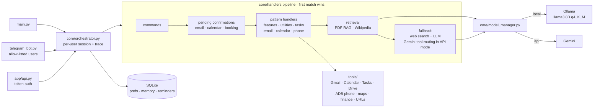

# Orchestrix

[](https://github.com/saisaharsh3/Orchestrix_AI-Multi-Model_Agentic_AI_Assistant/actions/workflows/ci.yml)

A personal assistant that runs on your own machine and decides, request by
request, whether the request needs a model at all, whether the on-device model
(Llama 3 8B via Ollama) is enough, or whether to use the cloud (Gemini).
It connects to Gmail, Google Calendar, Tasks and Drive, controls an Android
phone over ADB, answers questions about your PDFs entirely on-device, and is
reachable from a terminal, a Telegram bot, or an HTTP API.

## Highlights

- **Deterministic routing first.** A pipeline of pattern-based handlers covers
  common requests (tasks, calendar, email, weather, reminders, phone control)
  without calling a model to decide what to do.
- **Local-first privacy.** In local mode nothing is sent to a cloud model —
  including PDF content and email drafts. If the local model fails, you are
  told and choose `/api` yourself; there is no silent cloud fallback.
- **On-device PDF Q&A.** FAISS (`IndexFlatIP`, 384-dim MiniLM embeddings) with
  hybrid semantic + keyword retrieval and optional OCR for scanned pages.
- **Gemini function calling** (API mode) for phrasings the patterns miss,
  restricted to read-only tools (weather, prices, calendar, inbox, Drive).
- **Stealth Mode** normalises writing style before a query goes to the cloud,
  reducing cross-mode stylometric linkability by 18.5% in our experiment
  (see [research/](research/README.md)).
- **Confirm before acting.** Sending email and adding calendar events always
  wait for an explicit YES.

## Architecture



Each request is routed through `core/handlers/` in order; the stage that
answered it (0–4) is logged to `research/logs/orchestration_trace.jsonl`.

## Quick start

### 1. Prerequisites

- Python 3.10+
- [Ollama](https://ollama.com) with the default model:
  `ollama pull llama3:8b-instruct-q4_K_M`
- A [Gemini API key](https://aistudio.google.com/apikey) (for API mode)
- Optional: an NVIDIA GPU (20 layers are offloaded by default, `OLLAMA_NUM_GPU`),
  `adb` for phone control, ffmpeg for voice, Tesseract + Poppler for OCR

### 2. Install

```bash
git clone https://github.com/saisaharsh3/Orchestrix_AI-Multi-Model_Agentic_AI_Assistant.git
cd Orchestrix_AI-Multi-Model_Agentic_AI_Assistant
python -m venv venv
source venv/bin/activate          # Windows: venv\Scripts\activate
pip install -r requirements.txt
# optional extras
pip install -r requirements-voice.txt     # Whisper voice messages, mic input
pip install -r requirements-extras.txt    # OCR, BookMyShow browser automation
```

### 3. Configure

```bash
cp .env.example .env
```

Fill in at least `GEMINI_API_KEY`. Every setting is documented in
[.env.example](.env.example).

**Telegram bot:** create a bot with [@BotFather](https://t.me/BotFather), put
the token in `TELEGRAM_BOT_TOKEN`, and put your Telegram user id (ask
[@userinfobot](https://t.me/userinfobot)) in `TELEGRAM_ALLOWED_USER_IDS`.
The bot refuses to start without an allow-list: it can read your mail and
control your phone.

**Google APIs (Gmail, Calendar, Tasks, Drive):** in Google Cloud Console,
enable the four APIs, create an OAuth client of type *Desktop app*, and save
its JSON as `credentials/credentials.json`. The first Google request opens a
browser for consent and stores `credentials/token.json`.

### 4. Run

```bash
python main.py                                   # terminal
python telegram_bot.py                           # Telegram bot
uvicorn app.api:app --host 127.0.0.1 --port 8000 # HTTP API
```

API example:

```bash
curl -X POST localhost:8000/chat -F message="weather in Pune" -F model_type=local
```

Set `ORCHESTRIX_API_TOKEN` and send `Authorization: Bearer <token>` to allow
non-localhost clients.

### Docker

```bash
docker compose up -d
docker compose exec ollama ollama pull llama3:8b-instruct-q4_K_M
docker compose --profile api up -d api   # optional HTTP API on 127.0.0.1:8000
```

Authorise Google once on the host (so `credentials/token.json` exists) before
running in Docker; the consent flow needs a browser.

## What you can say

| Area | Examples |
|---|---|
| Everyday | `weather in Mumbai` · `convert 500 USD to INR` · `TCS stock price` · `bitcoin price` |
| Web | `summarize https://…` · `track price https://…` · `show tracked prices` |
| Google | `check my email` · `send email to a@b.com use ai write about the launch` · `add meeting with Ravi tomorrow at 3pm` · `add task buy milk` · `find resume on drive` |
| Reminders (Telegram) | `remind me to call mom at 6pm` · `show my reminders` |
| PDFs | send a PDF, then ask about it · `compare the two PDFs` · `generate a summary report` |
| Maps | `find restaurants nearby` · `directions to the airport` (share your location first) |
| Phone (ADB) | `open youtube` · `play lofi on spotify` · `set alarm for 7:30am` · `set volume to 40%` |
| Controls | `/api` · `/local` · `/web on` · `/rag on` · `/stealth_mode on` · `/status` |

## Performance (measured)

From [research/results/benchmark_results.json](research/results/benchmark_results.json)
on a Ryzen 7 6800HS / RTX 3050 Ti (4 GB) laptop:

| | Mean latency |
|---|---|
| Local, Llama 3 8B q4_K_M (Ollama) | 1.06 – 1.19 s |
| Cloud, Gemini Flash | 1.94 – 2.01 s |
| FAISS retrieval, one PDF | 6 – 19 ms per query |

Small samples (3 prompts × 3 runs; 5 retrieval queries). Reproduce with
`python scripts/benchmark.py`. The research experiments, what has and has
not been measured yet, and how to run them are in
[research/README.md](research/README.md).

## Project layout

```
app/            HTTP API (FastAPI)
config/         settings (single place that reads .env) and user preferences
core/
  orchestrator.py   request entry point, tracing
  handlers/         routing pipeline, one module per area
  session.py        per-user state (pending actions, toggles, PDFs)
  storage.py        SQLite persistence
  model_manager.py  local/cloud generation with the privacy rule
  tool_router.py    Gemini function calling over read-only tools
models/         Ollama and Gemini clients
rag/            FAISS vector store
tools/          integrations (Google, phone/ADB, maps, finance, URLs, search)
research/       experiments and results
scripts/        benchmarks
tests/          pytest suite (no network, no models needed)
```

## Development

```bash
pip install -r requirements-dev.txt
pytest                 # ~100 tests, all external services faked
ruff check .
pre-commit install     # ruff + secret scanning on every commit
```

CI runs lint and tests on Python 3.10 and 3.12.

## Limitations

- Intent detection is pattern-based; unusual phrasings fall through to the
  LLM (or to Gemini tool routing in API mode).
- Stealth Mode is a partial defence; the stylometry result comes from
  synthetic queries, not real users.
- Reminders and the daily briefing are Telegram-only.
- BookMyShow "automation" only opens the site; the booking steps are not automated yet.

## License

[MIT](LICENSE)
